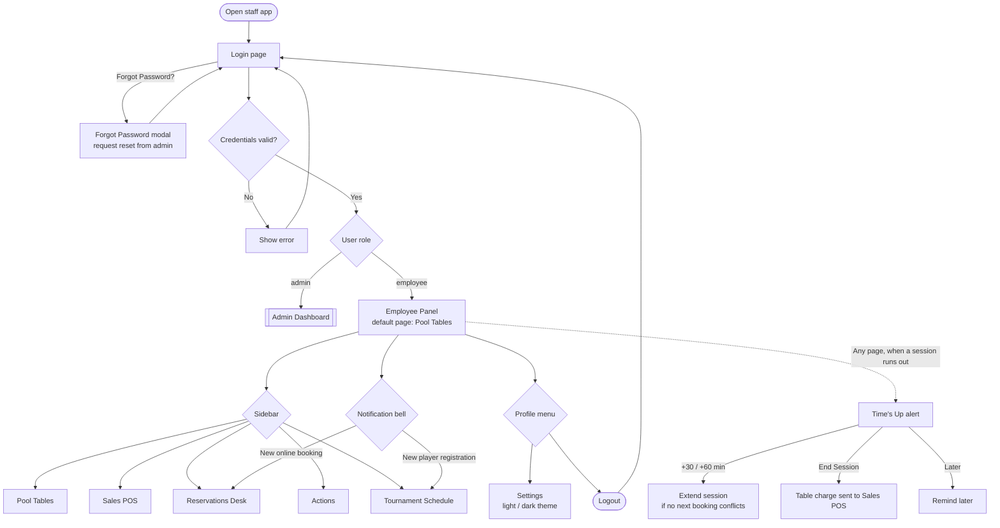
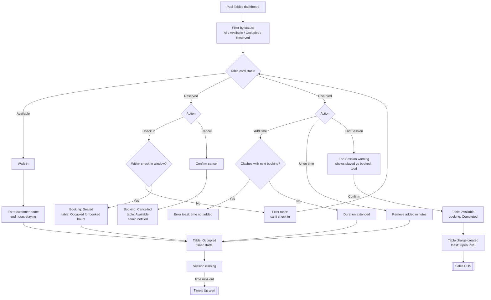
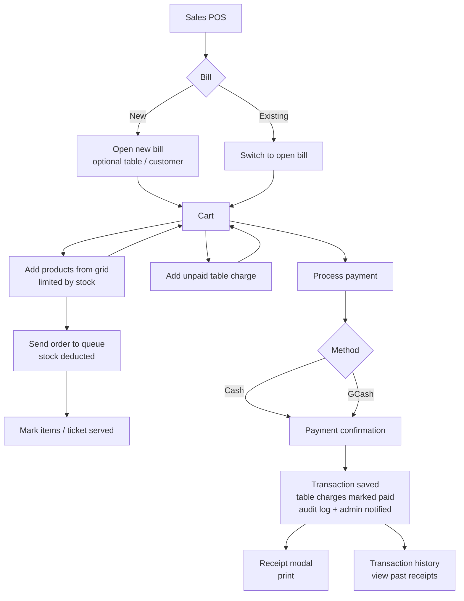
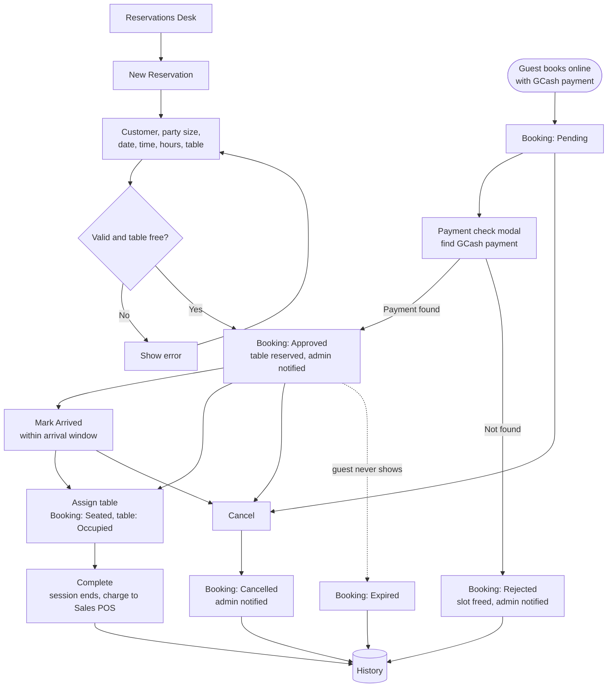
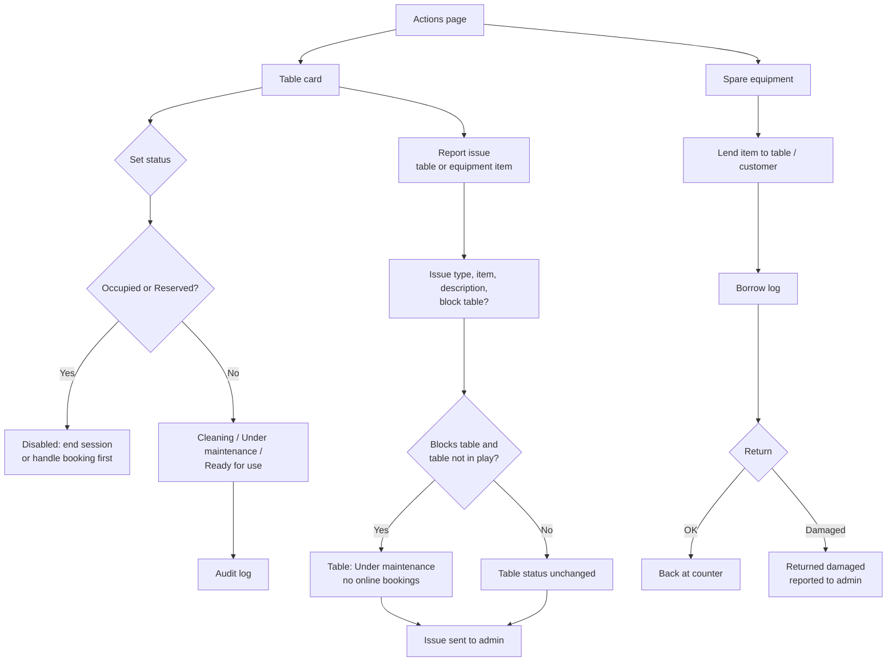
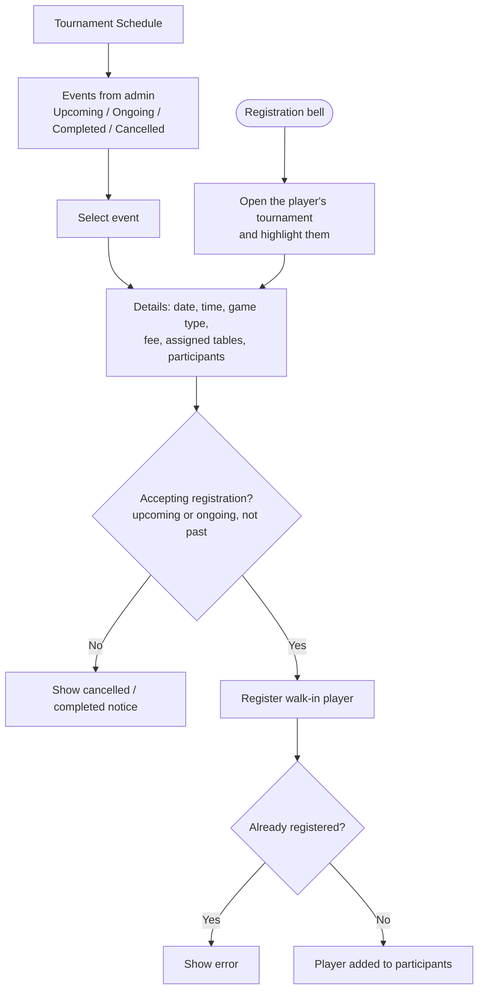

# Employee Side Flowchart

How an employee moves through the staff app, from login to each module in the
Employee Panel. Diagrams are Mermaid, so they render on GitHub.

## 1. Overview: login and navigation

## 2. Pool Tables

## 3. Sales POS

## 4. Reservations Desk

## 5. Actions (tables and equipment)

## 6. Tournament Schedule

