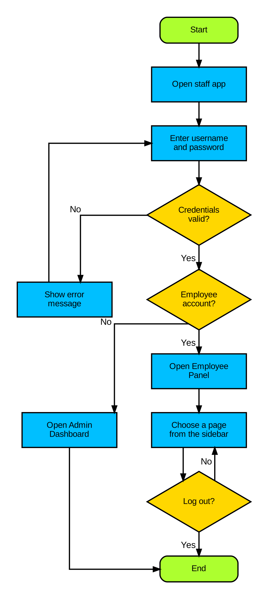
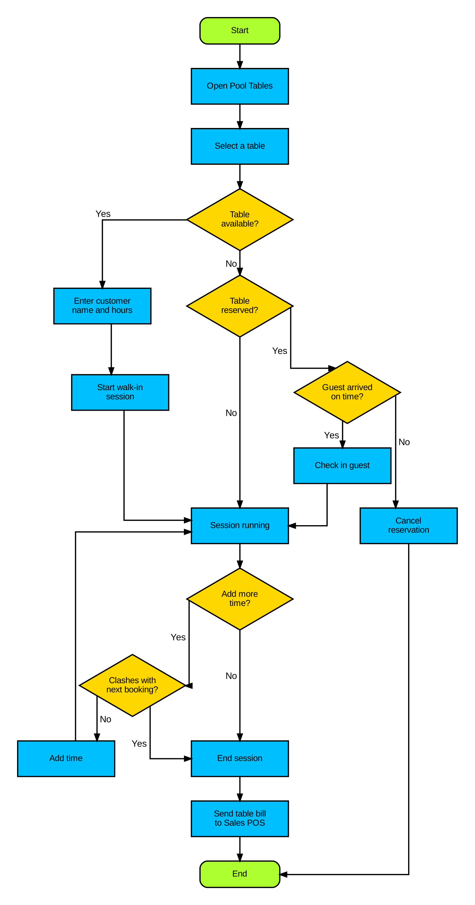
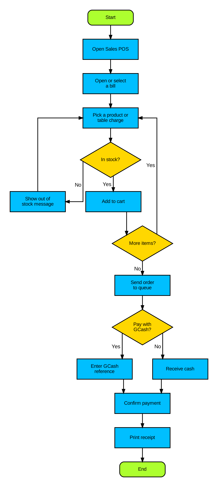
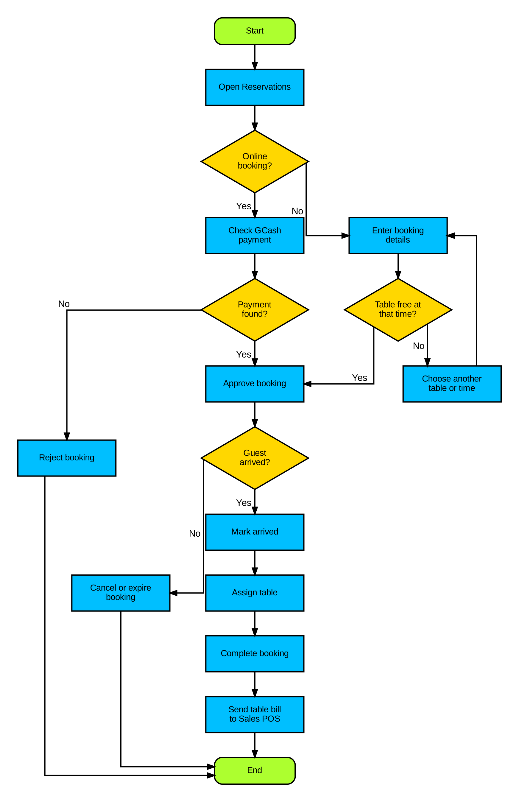
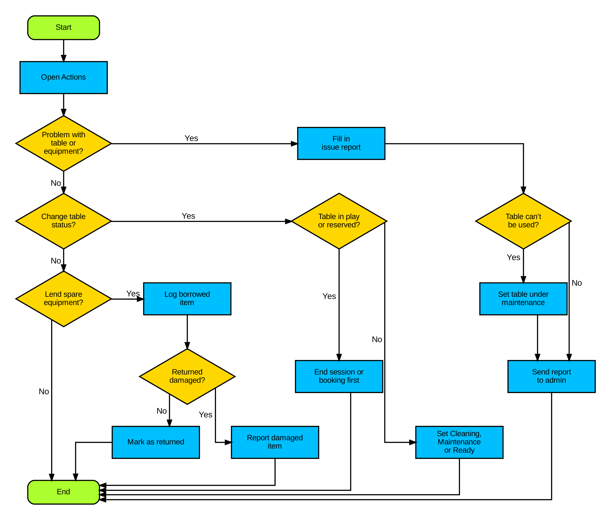
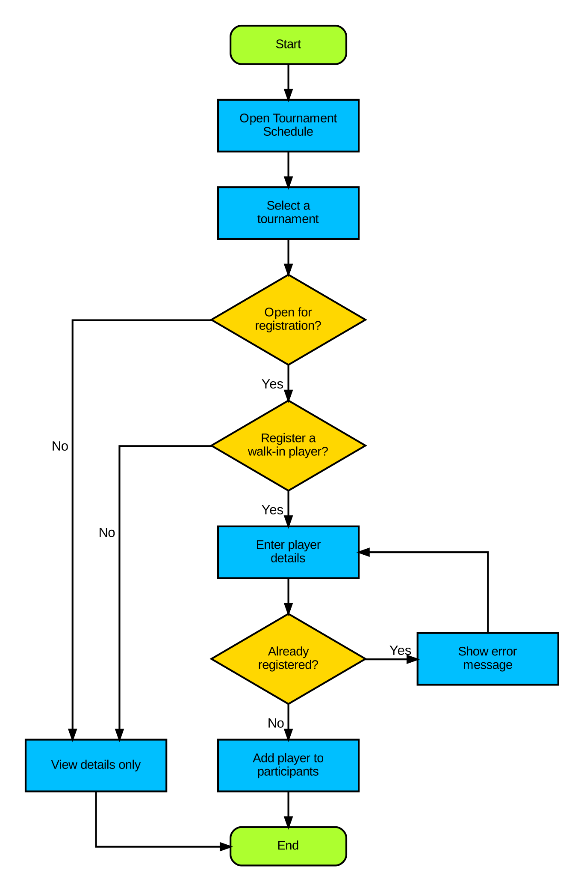

# Employee Side Flowchart

How an employee uses the staff app, one flowchart per page of the Employee Panel.

**Legend:** green = Start / End, yellow diamond = Yes/No decision, blue box = step.

To change a chart, edit `docs/flowcharts/build_flowcharts.py` and run
`python docs/flowcharts/build_flowcharts.py` (needs Graphviz).

## 1. Login and navigation

## 2. Pool Tables

## 3. Sales POS

## 4. Reservations Desk

## 5. Actions (tables and equipment)

## 6. Tournament Schedule

